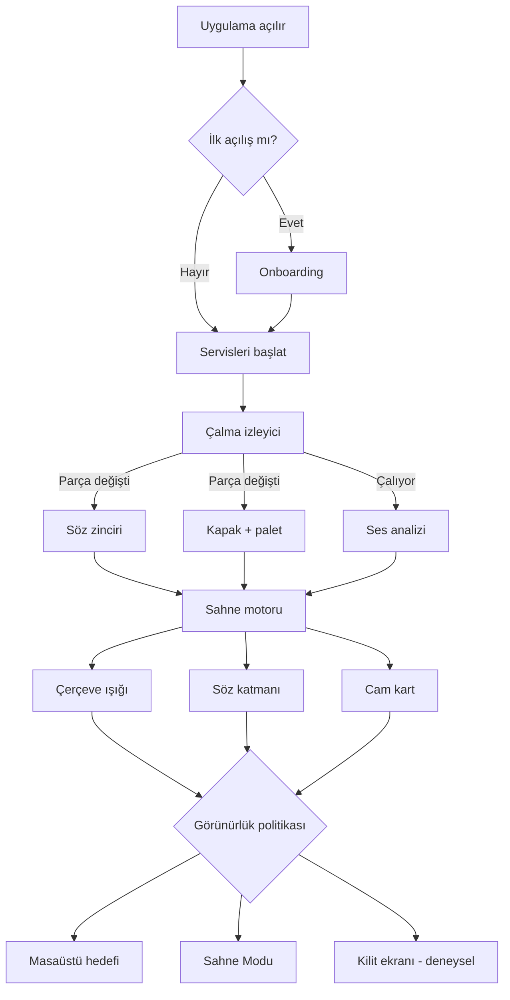
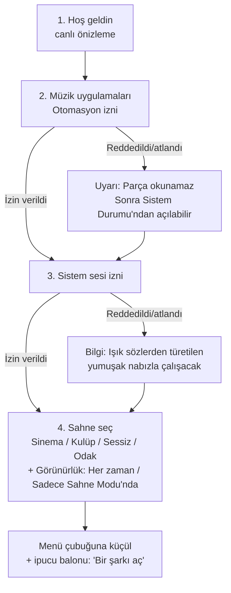
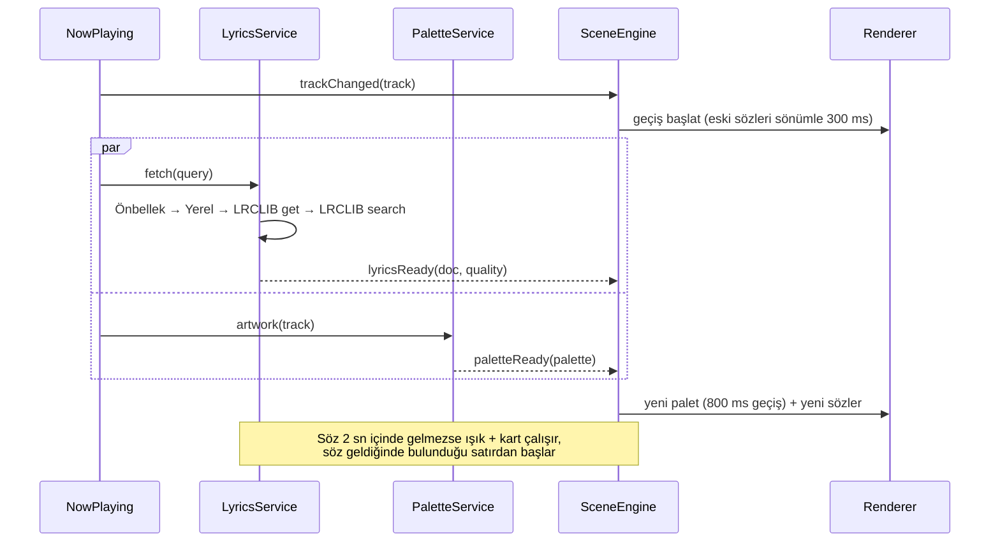
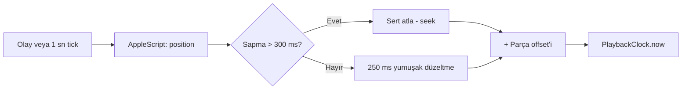
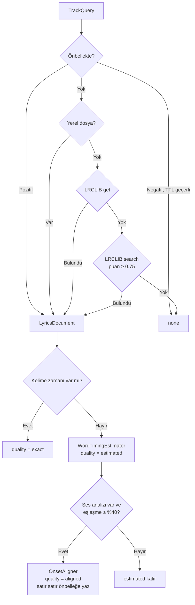
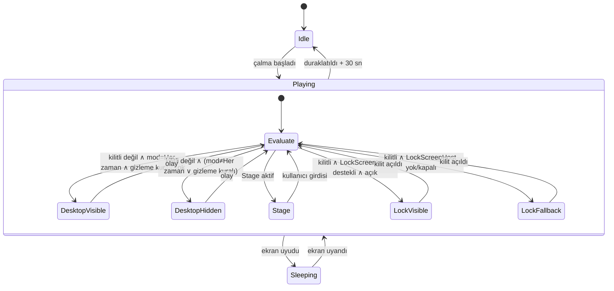
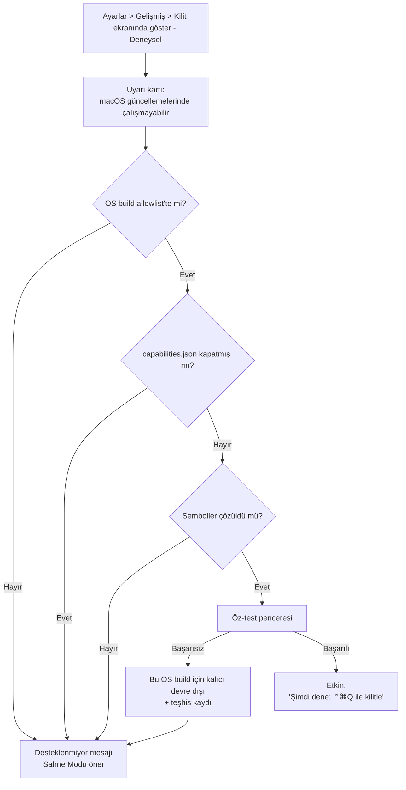
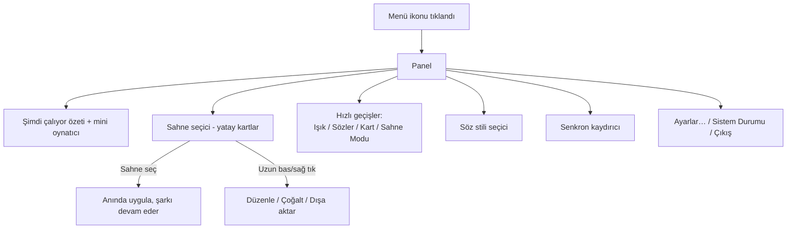
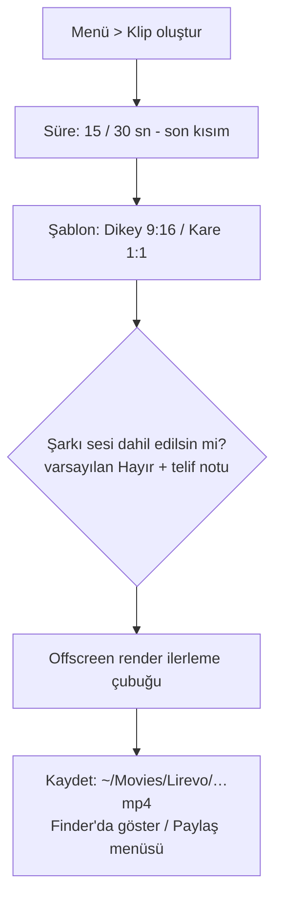

# App Flow — Lirevo

> Kullanıcı akışları, sistem akışları ve durum makineleri. Diyagramlar Mermaid formatındadır.

---

## 1. Genel bakış

## 2. İlk açılış (Onboarding)

Tek pencere, 4 adım. Her izin adımı atlanabilir; atlanan izin uygulamayı bozmaz, yalnız ilgili özellik düşük modda çalışır.

**Otomasyon izni ayrıntısı**
- macOS bu izni ilk Apple Event gönderiminde sorar. Onboarding'de "İzin ver" düğmesi, çalışan oynatıcıya zararsız bir sorgu (`player state`) gönderir. Oynatıcı kapalıysa: "Spotify veya Müzik'i aç, sonra tekrar dene" mesajı; uygulamayı biz açmayız.
- Her oynatıcı için ayrı izin istenir (Spotify, Müzik).

**Sahne ve görünürlük adımı**
- Varsayılan seçim "Her zaman" (`visibility.mode = always`). "Sadece Sahne Modu'nda" seçilirse masaüstü katmanı gizli kalır, sahne yalnızca Sahne Modu'nda görünür (`stageOnly`).
- "Sadece kilitliyken" (`lockedOnly`) onboarding'de sunulmaz; yalnız Ayarlar > Gelişmiş'te, deneysel kilit ekranı katmanı açıkken seçilebilir.

**Sistem sesi izni ayrıntısı**
- Açıklama metni: "Lirevo yalnızca Mac'inden çıkan sesin ritmini analiz eder. Mikrofon kullanılmaz, ses kaydedilmez."

## 3. Parça değişimi hattı

Kurallar:
- Hızlı atlamalarda (parçalar arası < 1.5 sn) önceki istek iptal edilir (`Task.cancel`).
- Söz `none` dönerse söz katmanı gizlenir; menüde "Bu şarkı için söz bulunamadı → Dosya ekle" seçeneği.
- `plainLyrics` var ama senkron yoksa: söz katmanı gösterilmez (yanlış senkron göstermektense hiç göstermemek), cam kartta "senkronsuz söz var" küçük ikonu → kullanıcı isterse yavaş kayan mod.

## 4. Çalma saati ve senkron düzeltme

**Kullanıcı senkron düzeltme**
1. Menü > "Senkron" kaydırıcısı (±2 sn) veya kısayol `⌃⌥⌘←/→` (±100 ms).
2. Değişiklik anında uygulanır, parça ID'sine kaydedilir.
3. "Sıfırla" düğmesi.

## 5. Söz sağlayıcı zinciri ve kelime zamanlaması

Ağ hatası: zincir bir sonraki sağlayıcıya geçer; ağ yoksa negatif önbelleğe **yazılmaz** (bağlantı gelince tekrar denenir).

## 6. Görünürlük durum makinesi

| Durum | Işık | Sözler | Kart | Ekran uyanık tut | Ses tap |
|---|---|---|---|---|---|
| Idle | Kapalı (veya "Sabit idle" ayarı açıksa sabit) | Kapalı | Kapalı | Hayır | Kapalı |
| DesktopVisible | Açık | Açık | Ayara göre | Evet | Açık |
| DesktopHidden | Ayara göre ("sadece ışık" mümkün) | Kapalı | Kapalı | Yalnız ışık görünürse evet | Işık açıksa açık |
| Stage | Açık | Açık (büyük) | Açık | Evet | Açık |
| LockVisible | Açık | Açık | Açık | Evet | Açık |
| LockFallback | Kapalı | Kapalı | Kapalı | Hayır | Kapalı |
| Sleeping | Render durur | Render durur | — | Hayır | Kapalı |

**Görünürlük modları** (`visibility.mode`): `always` (varsayılan; masaüstü katmanı açık), `stageOnly` (masaüstü gizli, yalnız Sahne Modu), `lockedOnly` (masaüstü gizli; kilit ekranında gösterim; yalnız deneysel kilit ekranı katmanı açıkken seçilebilir, katman kapatılırsa `always`'e döner).

**Ekranı uyanık tutma kuralı**: `display.keepAwake` açıksa, assertion yalnızca *müzik çalıyor* ∧ *en az bir sunum hedefi (ışık, sözler veya kart) görünür* olduğunda tutulur; duraklatmadan 30 sn sonra veya hiçbir hedef görünmez olunca bırakılır. Tablodaki "Ekran uyanık tut" sütunu bu kuralın sonucudur.

**Olaylar**: kilit/kilit açma, ekran uyku/uyanma, çalma/duraklatma, ön plan uygulama değişimi, ekran yapılandırma değişimi, panik gizle kısayolu, Stage aç/kapa, ayar değişimi, güç durumu değişimi.

**Panik gizle** (`⌃⌥⌘H`): Tüm hedefleri 0 ms'de gizler, tekrar basılana kadar `Evaluate` atlanır.

## 7. Kilit ekranı (deneysel) etkinleştirme akışı

Çalışma zamanı: Her kilitlenmede host etkinleştirilir; hata fırlatırsa o oturum için `LockFallback` durumuna geçilir, bir sonraki kilit açılışta kullanıcıya tek seferlik bildirim gösterilir.

## 8. Sahne Modu akışı

1. Tetikleyiciler: menü "Sahne Modu", kısayol `⌃⌥⌘S`, veya "X dk boşta kalınca Sahne Modu" (varsayılan kapalı; 1–30 dk).
2. Açılış: 400 ms karartma → tam ekran sahne (ışık + büyük sözler + kart).
3. Kapanış: herhangi bir tuş, tıklama veya 8 pt üzeri fare hareketi → 250 ms açılma.
4. Çoklu ekran: ana ekranda sözler, diğer ekranlarda yalnız ışık + bulanık kapak (ayar).
5. İlk kullanımda tek seferlik bilgi: "Sahne Modu kilit değildir; uzaklaşacaksan ⌃⌘Q."

## 9. Menü çubuğu etkileşimi

Menü ikonu durumları: normal, çalıyor (hafif nabız; Hareketi Azalt'ta sabit), uyarı (sarı nokta: bir alt sistem `unavailable`).

## 10. Ayarlar akışı

Ayar penceresi sekmeleri (7): **Sahneler · Sözler · Işık · Kart · Ekranlar · Kısayollar · Gelişmiş**. Ayrıntılar `ui_ux_brief.md` §6.

Sahne düzenleme kuralı: Bir sahne seçiliyken Işık/Sözler sekmesindeki değişiklik o sahneyi "değiştirilmiş" olarak işaretler; "Sahneyi güncelle" veya "Yeni sahne olarak kaydet".

## 11. Sistem Durumu (teşhis) akışı

| Alt sistem | Durum örnekleri | Kullanıcı aksiyonu |
|---|---|---|
| Spotify bağlantısı | Bağlı / İzin yok / Uygulama kapalı | İzni aç (Sistem Ayarları derin bağlantısı) |
| Müzik bağlantısı | Aynı | Aynı |
| Sistem sesi | Analiz ediliyor / İzin yok (yumuşak nabız) | İzni aç |
| Söz kaynağı | Bu şarkı: LRCLIB, aligned / Bulunamadı | Dosya ekle |
| Kilit ekranı katmanı | Kapalı / Etkin / Bu macOS'ta desteklenmiyor | Sahne Modu'nu dene |
| Güç | AC 60 fps / Pil 30 fps / Termal kısıtlama | — |
| Güncelleme | Güncel / Yeni sürüm var | Güncelle |

"Teşhis paketini kopyala" düğmesi.

## 12. Klip dışa aktarma akışı (v1.5)

## 13. Hata ve düşük mod matrisi

| Hata | Etki | Davranış |
|---|---|---|
| Otomasyon izni yok | Parça bilgisi yok | Sahne motoru boşta; ışık "Sabit idle" modda ses tap'e göre çalışabilir; menüde uyarı |
| Sistem sesi izni yok | Ritim yok | SyntheticPulse |
| Söz bulunamadı | Söz katmanı yok | Işık + kart devam |
| Kapak yok | Palet yok | Son palet veya sahnenin varsayılan renkleri |
| Ağ yok | Yeni söz/kapak yok | Önbellek; negatif önbelleğe yazma |
| Metal cihaz hatası | Işık render edilemez | Işık `unavailable`, sözler SwiftUI yedek (shader'sız) |
| Kilit host hatası | Kilit ekranında görüntü yok | LockFallback + tek seferlik bildirim |
| Ekran tak/çıkar | Pencereler geçersiz | Yeniden kurulum, sahne kesintisiz |
| AppleScript zaman aşımı | Pozisyon güncel değil | Tahmin devam eder, geri çekilme |

## 14. Güncelleme akışı

- Sparkle günlük kontrol → bildirim → "Yükle ve yeniden başlat". Kilitliyken veya Stage'de güncelleme penceresi gösterilmez, sonraya ertelenir.
- Lisans akışı yoktur (açık kaynak, GPL-3.0-or-later).
